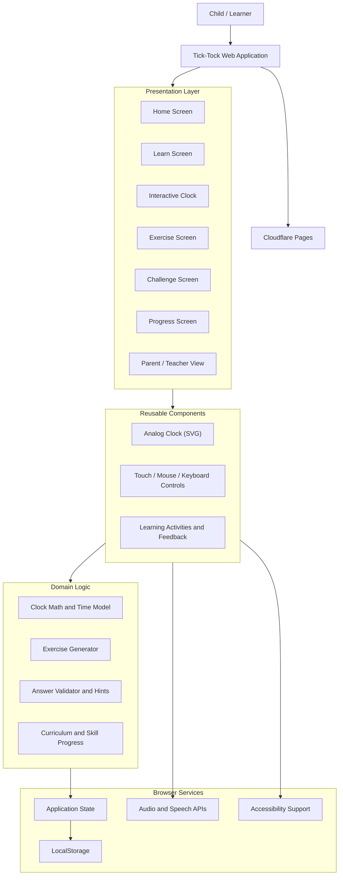

# Tick-Tock – Interactive Clock Learning Game for Kids

**Tick-Tock** is an interactive, touchscreen-friendly educational web application designed to help children learn how to read analog and digital clocks through engaging lessons, hands-on activities, and fun challenges.

**Live Application:** https://tick-tock-94r.pages.dev/

## 1. Project Objectives

- Help children identify clock components, including the hour hand, minute hand, and minute markings.
- Teach children to read and understand analog and digital time.
- Explain o'clock, half-past, quarter-past, quarter-to, and five-minute intervals.
- Introduce exact minute reading from 00 to 59.
- Provide interactive exercises to practise setting and reading time.
- Develop children's understanding of time through everyday activities.
- Support touchscreen, mouse, and keyboard interactions.
- Encourage independent learning through challenges, hints, and feedback.

## 2. Key Features

- **Interactive Analog Clock:** Explore the movement and relationship between hour and minute hands.
- **Minute Markings:** Learn minute positions from 00 to 59, including smaller labels between major hour numbers.
- **Step-by-Step Learning:** Understand clock concepts through progressive learning activities.
- **Time-Setting Activities:** Practise setting the clock to specific times.
- **Interactive Exercises:** Answer questions and test time-reading skills.
- **Challenges:** Reinforce learning through mixed activities.
- **Hints and Feedback:** Receive guidance and encouraging responses.
- **Touchscreen-Friendly Interface:** Interact with clock elements using touch, mouse, or keyboard.
- **Progress Tracking:** Monitor learning progress where implemented.
- **Responsive Design:** Support different screen sizes and devices.

## 3. Learning Path

| Level | Learning Topic | Description |
|---|---|---|
| 1 | Clock Parts | Identify clock numbers, hour hand, minute hand, and markings. |
| 2 | O'clock | Learn to read whole hours. |
| 3 | Half-Past | Understand 30-minute intervals. |
| 4 | Quarter-Past and Quarter-To | Learn 15-minute and 45-minute positions. |
| 5 | Five-Minute Intervals | Read time by counting in groups of five. |
| 6 | Exact Minutes | Read individual minute positions from 00 to 59. |
| 7 | Daily-Life Activities | Connect time concepts with everyday routines. |
| 8 | Mixed Challenges | Practise all learned concepts through combined activities. |

## 4. System Architecture

Tick-Tock follows a client-first architecture with separate layers for presentation, reusable components, domain logic, and browser services.

### Architecture Diagram

### Architecture Layers

| Layer | Responsibility |
|---|---|
| Presentation Layer | Displays application screens and learning activities. |
| Reusable Components | Provides the interactive clock, controls, and reusable UI elements. |
| Domain Logic | Handles clock calculations, exercise generation, answer validation, and curriculum rules. |
| Browser Services | Supports application state, local storage, audio, speech, and accessibility. |
| Hosting | Makes the application accessible through Cloudflare Pages. |

### Clock Design

The analog clock is designed using scalable SVG graphics.

- Displays 12 major hour positions.
- Supports 60 minute positions around the clock.
- Shows hour and minute hands.
- Supports minute labels, including individual minute values between major hour numbers.
- Allows interactive clock exploration and time-setting activities.

---

**Tick-Tock – Learn Time the Fun Way!**
