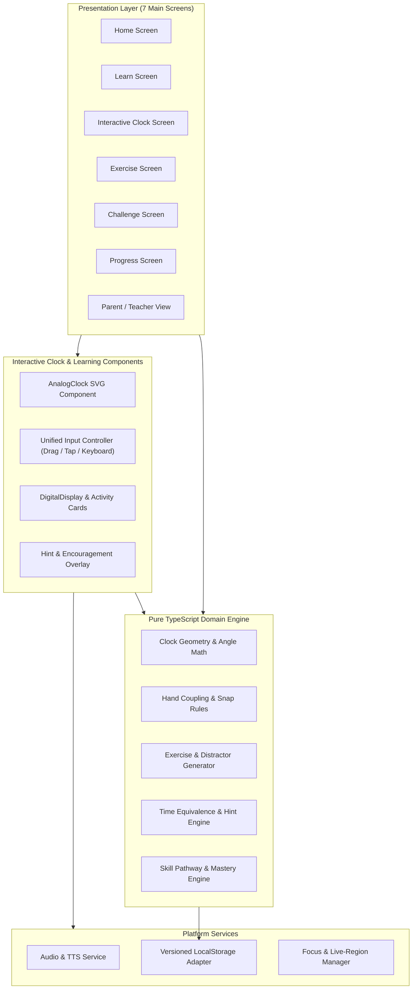
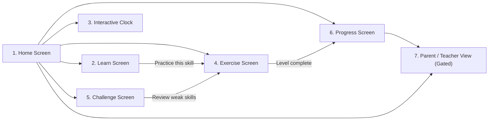

# Tick-Tock: System Architecture Document

## 1. Overview & Architectural Goals

**Tick-Tock** is a responsive, touch-first educational web application designed to teach children how to read analog and digital clocks. Derived from [`problemStatement.md`](./problemStatement.md), this architecture prioritizes:

1. **Touch-First Precision & Accessibility:** Seamless interaction via touchscreens (drag and tap-to-set), mouse, and full keyboard navigation without relying on color alone.
2. **Zero-Friction Client-First Execution:** Instant load and offline-tolerant operation in any modern browser using local persistence—requiring no mandatory login or server round-trips during learning activities.
3. **Crisp Scalable Rendering:** Resolution-independent analog clock rendering with optional `00`–`59` minute markings that remain legible across smartphones, tablets, and desktops.
4. **Child-Safe & Encouraging UX:** Immediate, constructive hints, optional timers, audio read-aloud support, and a gently gated Parent/Teacher summary view.

---

## 2. Recommended Technology Stack

| Layer | Choice | Rationale |
| :--- | :--- | :--- |
| **Framework & Build** | React 18+ with TypeScript & Vite | Fast startup, strict type safety for clock math/state, and static bundle output deployable to any CDN/host. |
| **Routing** | React Router (or hash/client router) | Clean navigation across the 7 main screens with browser back/forward safety during exercises. |
| **Clock Rendering** | Custom Declarative SVG (`viewBox`) | Vector sharpness at all DPIs, native DOM hit-targets, ARIA roles per hand, and clean layered visibility for `00`–`59` minute labels. |
| **Styling** | Tailwind CSS + CSS Custom Properties | Rapid responsive layout utilities, high-contrast semantic tokens, and safe-area/orientation adaptability. |
| **State & Persistence** | Zustand (or React Context + Reducer) + `localStorage` | Lightweight deterministic state management with versioned local persistence and schema migration. |
| **Audio & Speech** | Web Speech API (`speechSynthesis`) + Web Audio API | Zero-asset synthesized chimes/feedback and spoken instructions with graceful fallback when unavailable. |
| **Testing** | Vitest + React Testing Library + Playwright | Unit testing for clock geometry/validators, component tests for accessibility, and E2E tests across touch/mobile viewports. |

---

## 3. High-Level System Architecture



---

## 4. Proposed Folder Structure

```text
src/
├── app/
│   ├── App.tsx                 # Root layout, router, global providers
│   ├── routes.tsx              # Route definitions for the 7 main screens
│   └── theme.css               # High-contrast tokens, font scale, touch-target rules
├── domain/
│   ├── clockMath.ts            # Polar/Cartesian conversions, angle normalization, wrap-around
│   ├── clockModel.ts           # TimeValue { hours, minutes }, 12h/24h formatting, hand modes
│   ├── curriculum.ts           # Skill levels, prerequisites, unlock rules
│   ├── exerciseGenerator.ts    # Question factories for all modules & difficulty tiers
│   └── validator.ts            # Answer evaluation, partial feedback, contextual hints
├── services/
│   ├── audioService.ts         # Web Audio tones + Web Speech TTS queue & mute state
│   ├── storageService.ts       # Versioned localStorage read/write/reset/export
│   └── telemetry.ts            # Local-only attempt history & skill accuracy aggregation
├── store/
│   └── useAppStore.ts          # Global progress, active settings, review queue
├── components/
│   ├── clock/
│   │   ├── AnalogClock.tsx     # SVG clock face, ticks, numbers, hands, hit overlays
│   │   ├── MinuteRing.tsx      # Optional 00–59 and 5-minute interval labels
│   │   ├── ClockHands.tsx      # Distinct hour/minute hands with non-color cues & ARIA
│   │   └── TapToSetPad.tsx     # Accessible tap/stepper alternative controls
│   ├── learning/
│   │   ├── DigitalReadout.tsx  # Clear HH:MM display + optional AM/PM / part-of-day badge
│   │   ├── ChoiceGrid.tsx      # Large touch-friendly multiple-choice cards
│   │   ├── DailyActivityCard.tsx # Illustrated daily routine prompts
│   │   └── HintBanner.tsx      # Encouraging non-punitive feedback & visual hints
│   └── layout/
│       ├── AppShell.tsx        # Top nav, audio toggle, back confirmation, responsive frame
│       └── ParentGate.tsx      # Simple child-safe gate for Parent/Teacher view
├── screens/
│   ├── HomeScreen.tsx
│   ├── LearnScreen.tsx
│   ├── InteractiveClockScreen.tsx
│   ├── ExerciseScreen.tsx
│   ├── ChallengeScreen.tsx
│   ├── ProgressScreen.tsx
│   └── ParentTeacherScreen.tsx
└── tests/
    ├── unit/                   # Geometry, generator, validator, storage migration tests
    ├── component/              # Clock interaction, ARIA, hint flow tests
    └── e2e/                    # Playwright mobile/tablet/desktop flows
```

---

## 5. Core Subsystem Designs

### 5.1 SVG Clock & Coordinate Architecture

- **Fixed Logical ViewBox:** The clock renders inside `viewBox="0 0 400 400"` centered at `(200, 200)`. All radii scale proportionally, guaranteeing identical hit geometry across devices while adapting container size via CSS (`min(85vw, 65vh)`).
- **Radial Layering (Inside → Outside):**
  1. **Center Pivot (`r = 0–10`)**: Decorative cap covering hand origins.
  2. **Hands Layer (`r = 0–135`)**:
     - **Hour Hand:** Shorter (`r ≈ 85`), thicker, distinct primary color (e.g., Warm Coral/Orange `#E05A2B`), rounded/arrow silhouette, optional `"H"` or `"Hour"` subtle badge in Learn mode.
     - **Minute Hand:** Longer (`r ≈ 132`), sleeker, distinct contrasting color (e.g., Deep Teal/Blue `#1D6FA5`), pointed silhouette, optional `"M"` or `"Min"` badge in Learn mode.
  3. **Tick Marks (`r = 136–148`)**: 60 radial ticks (thick major ticks every 5 minutes, thin minor ticks for intermediate minutes).
  4. **Hour Numbers (`r ≈ 118` or `r ≈ 162` depending on ring mode)**: Numbers `1`–`12` with generous font weight.
  5. **Minute Ring (`r ≈ 182`, outer margin)**: Optional `00`–`59` labels (`00` at 12, `05` at 1, `01`–`04` in between). Supports 3 visibility presets:
     - `all`: `00`–`59` (all 60 labels; `00, 05, 10...` bolded/slightly larger, `01..04` smaller yet legible).
     - `fives`: Only `00, 05, 10, ..., 55`.
     - `none`: Hidden for independent practice.
- **Non-Color Differentiation:** Hour and minute hands differ in **length, stroke width, tip geometry, and optional text labels**, ensuring usability for color-vision-deficient learners.

### 5.2 Unified Input & Hand Physics Engine

The clock supports three equivalent input modalities through a single normalized state updater:

1. **Touch / Mouse Dragging (Pointer Events):**
   - Invisible wide transparent hit paths (`strokeWidth >= 32` in SVG units) surround each hand so small fingers never miss thin visuals.
   - `touch-action: none` on the SVG prevents accidental page scrolling during dragging.
   - `element.setPointerCapture(pointerId)` locks active drag to one finger/cursor until `pointerup`/`pointercancel`.
   - Angle calculation from clock center `(cx, cy)` to pointer `(px, py)`:
     - $\theta = (\text{atan2}(px - cx, -(py - cy)) \times \frac{180}{\pi} + 360) \bmod 360$ (so `0°` is at 12 o'clock and increases clockwise).
2. **Tap-to-Set Mode (Motor Accessibility & Small Screens):**
   - User selects active hand (`Hour` or `Minute` toggle pill, or taps near a hand) and taps anywhere around the clock dial—or taps a specific hour/minute target—to snap that hand directly to the tapped angle.
   - Optional `+1 min / -1 min` and `+1 hr / -1 hr` stepper buttons for fine adjustment.
3. **Keyboard Controls:**
   - Hour and minute hands are focusable SVG `<g>` elements (`tabIndex={0}`, `role="slider"`, `aria-valuemin`, `aria-valuemax`, `aria-valuenow`, `aria-valuetext`).
   - `ArrowUp`/`ArrowRight` increments; `ArrowDown`/`ArrowLeft` decrements (`1` hour for hour hand; `1` minute or `5` minutes when `Shift` or coarse mode is active for minute hand).

**Hand Coupling Modes:**
- **Geared Mode (Default for realistic clock learning & challenges):**
  - Moving the minute hand smoothly moves the hour hand (`hourAngle = (hours % 12) * 30 + minutes * 0.5`).
  - Crossing `59 → 00` clockwise increments `hours` (wrapping `12 → 1`); crossing `00 → 59` counter-clockwise decrements `hours` (wrapping `1 → 12`).
  - Moving the hour hand updates `hours` while preserving `minutes` (or snapping to nearest hour in beginner o'clock lessons).
- **Independent Mode (Optional for early Learn / Set-Time scaffolding):**
  - Hour and minute hands can be positioned independently before checking, allowing the validator to diagnose whether a child confused the hour vs. minute hand (e.g., setting `3:00` backwards as `12:15`).

### 5.3 Progressive Curriculum & Learning Modules

Skills are organized into a sequential pathway (`SkillId`) that supports both guided unlocking and optional Parent/Teacher override ("Unlock All"):

1. `clock-parts`: Identify hour hand, minute hand, numbers `1`–`12`, and 60 minute spaces.
2. `oclock`: Read and set whole hours (`:00`).
3. `half-past`: Read and set half hours (`:30`), reinforcing that the hour hand sits halfway between hours.
4. `quarter-past-to`: Read and set `:15` and `:45` (understanding "quarter past" and "quarter to" the *next* hour).
5. `five-minutes`: Read and set 5-minute intervals (`:05`, `:10`, ..., `:55`).
6. `exact-minutes`: Read and set any minute `00`–`59` using the full minute ring, then without it.
7. `daily-life`: Associate routine illustrations (waking up, school, lunch, play, homework, bedtime) with plausible clock times.
8. `challenge-mix`: Mixed multi-step mastery (analog→digital, digital→analog, set-time) with optional timer.

### 5.4 Exercise Validation & Supportive Hint Engine

- Rather than returning a binary pass/fail, `validator.ts` classifies mistakes to generate kid-friendly hints:
  - **Swapped Hands:** User set `12:15` instead of `3:00` → *"Almost! You put the long minute hand on 3. Try pointing the short coral hour hand at 3 and the long minute hand at 12!"*
  - **Off-by-One Hour on Quarter-To / Near-Hour Times:** User set `4:45` instead of `3:45` → *"Look closely! At 3:45 (quarter to 4), the hour hand is close to 4, just before reaching it."*
  - **Five-Minute vs. Hour Number Confusion:** User read `:04` instead of `:20` when pointing at `4` → *"Remember each big number is 5 minutes! Count by 5s from 12: 5, 10, 15, 20."*
  - **Close Minute Tolerance (Configurable):** In touch drag at exact-minute levels, exact match is required after snap-to-tick (every `6°` = 1 minute), eliminating sub-degree drag frustration.
- **Retry & Review Queue:** Wrong attempts show a hint without losing progress, allow retry, and record the `SkillId` in a local `reviewQueue` surfaced in Challenge / Review practice.

### 5.5 Audio & Accessibility Architecture

- **Spoken Prompts (`speechSynthesis`):** Read-aloud speaker button on every question and hint, plus optional auto-read toggle. Handles missing voices, empty utterance queues (`cancel()` before `speak()`), and browser autoplay restrictions (activated on first user tap).
- **Sound Effects (`AudioContext`):** Lightweight Web Audio oscillator chimes for correct answers, gentle soft click for minute ticks, and neutral soft tone for hints (never harsh buzzer sounds).
- **Screen-Reader Support:** Polite `aria-live="polite"` announcements when a prompt loads, hands move via keyboard, or a hint appears.
- **Visual Accessibility:** Minimum 4.5:1 text contrast, minimum `48×48px` interactive targets, `prefers-reduced-motion` support to disable celebration confetti/clock sweep animations.

---

## 6. Data Model & Local Persistence Schema

Stored in `localStorage` under a versioned key (`tick_tock_state_v1`):

```typescript
export type SkillId =
  | 'clock-parts'
  | 'oclock'
  | 'half-past'
  | 'quarter-past-to'
  | 'five-minutes'
  | 'exact-minutes'
  | 'daily-life'
  | 'challenge-mix';

export type MinuteLabelMode = 'all' | 'fives' | 'none';
export type InputMode = 'drag' | 'tap' | 'both';

export interface UserSettings {
  soundEnabled: boolean;
  ttsEnabled: boolean;
  minuteLabelMode: MinuteLabelMode;
  showDigitalOnExplore: boolean;
  challengeTimerEnabled: boolean;
  gearedHands: boolean;
  unlockAllSkills: boolean;
}

export interface SkillProgress {
  skillId: SkillId;
  unlocked: boolean;
  starsEarned: number;       // 0..3 per level or cumulative
  attempts: number;
  correctFirstTry: number;
  lastPracticedAt: string | null;
}

export interface ReviewItem {
  id: string;
  skillId: SkillId;
  activityType: 'set-time' | 'match-digital' | 'match-analog' | 'daily-life';
  targetTime: { hours: number; minutes: number };
  missedCount: number;
}

export interface PersistedAppState {
  schemaVersion: 1;
  settings: UserSettings;
  totalStars: number;
  badges: string[];
  skills: Record<SkillId, SkillProgress>;
  reviewQueue: ReviewItem[];
}
```

- **Storage Resilience:** All reads pass through a safe JSON parser + schema validator with defaults fallback so corrupted or outdated `localStorage` never crashes the app.
- **Parent/Teacher Gate:** Accessing `/parent` prompts a lightweight child-resistant check (e.g., *"Hold button for 2 seconds"* or a simple multiplication check like `4 × 3 = ?`) to protect settings and progress reset controls from accidental taps.

---

## 7. Screen Flow & Navigation Model



---

## 8. Non-Functional & Quality Constraints

- **Performance:** Initial JS bundle target < 250 KB gzipped; 60fps hand dragging using `requestAnimationFrame` or lightweight React state updates isolated to hand transforms (`transform="rotate(...)"`).
- **Privacy & Compliance:** Zero external analytics, zero personal data collection (no child names/emails required), 100% client-side storage.
- **Browser & Device Matrix:** Latest Chrome, Safari (iOS/iPadOS), Firefox, Edge across `320px` (small phone portrait) through `1440px+` (desktop).

