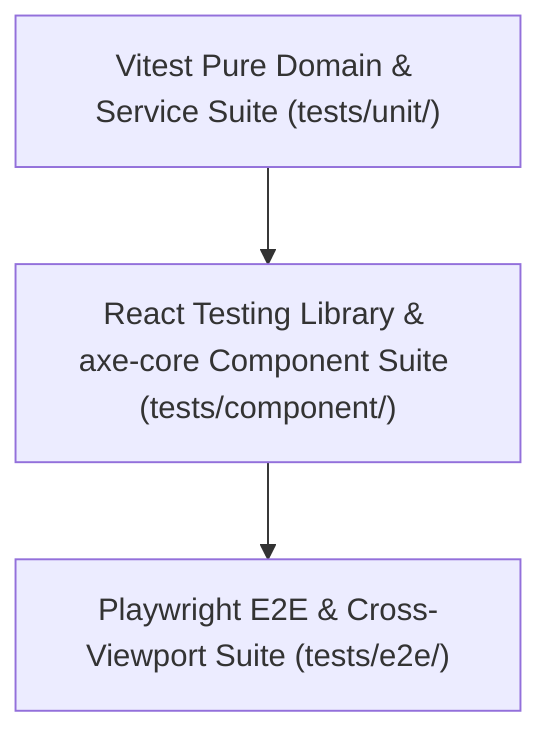

# Tick-Tock: Evaluation & Verification Specification (`eval.md`)

This document defines the evaluation criteria, test gates, rubrics, and release readiness scorecard for **Tick-Tock: An Interactive Clock Learning Game for Children**, derived directly from [`implementation-plan.md`](./implementation-plan.md) and cross-referenced with [`architecture.md`](./architecture.md), [`edge-case.md`](./edge-case.md), and [`problemStatement.md`](./problemStatement.md).

---

## 1. Evaluation Philosophy & Global Release Gates

Every phase in [`implementation-plan.md`](./implementation-plan.md) has a mandatory **Exit Gate**. A phase is considered complete only when all automated checks pass and manual/ergonomic rubrics meet the minimum bar below:

| Dimension | Target Metric / Gate | Verification Method |
| :--- | :--- | :--- |
| **Domain & Math Correctness** | 100% pass on all unit tests for `clockMath.ts`, `clockModel.ts`, `exerciseGenerator.ts`, `validator.ts`, and `curriculum.ts`. | Vitest (`tests/unit/`) |
| **Interaction & Input Parity** | Touch drag, mouse drag, Tap-to-Set, and keyboard (`Tab` + `Arrow` / `Shift+Arrow`) can each complete all clock-setting tasks. | React Testing Library (`tests/component/`) + Playwright (`tests/e2e/`) |
| **Responsive & Layout Stability** | Zero horizontal overflow and zero off-screen primary actions across `320×568`, `360×640`, `667×375` (landscape), `768×1024`, and `1280×800`; `0` layout shift when toggling `MinuteRing`. | Playwright viewport & bounding-box assertions |
| **Accessibility (WCAG AA+)** | `0` critical/serious `axe-core` violations; `>= 48×48px` interactive targets; `>= 4.5:1` text contrast; non-color hand differentiation; `prefers-reduced-motion` honored. | `axe-core` + keyboard walkthrough + grayscale/forced-colors check |
| **Performance & Resilience** | Initial JS bundle `< 250 KB` gzipped; smooth `60fps` hand dragging; zero uncaught errors with blocked `AudioContext`/`speechSynthesis` or disabled/corrupted `localStorage`. | Vite build stats + Playwright + fault-injection unit tests |

---

## 2. Test Pyramid & Verification Tooling

- **Unit (`tests/unit/`):** Fast, deterministic tests covering angle math, wrap-around, distractor uniqueness, mistake diagnosis, curriculum unlocks, TTS formatting, and `localStorage` resilience.
- **Component (`tests/component/`):** DOM + Pointer/Keyboard event tests for `AnalogClock`, `MinuteRing`, `TapToSetPad`, `ExerciseScreen`, `ChallengeScreen`, and `ParentGate`.
- **E2E (`tests/e2e/`):** Real browser tests simulating touch drags, mobile viewports, orientation constraints, page reloads, and full learner journeys.

---

## 3. Phase-Wise Evaluation Gates

### Phase 0: Project Scaffolding, Design System & Routing Shell
- **Evaluated Artifacts:** `src/app/theme.css`, `src/app/routes.tsx`, `src/components/layout/AppShell.tsx`, `src/services/storageService.ts`, `src/store/useAppStore.ts`.
- **Automated Checks:**
  - `npm run build` compiles with `0` TypeScript or bundler errors.
  - `storageService` unit tests pass for defaults initialization, malformed JSON recovery (`EC-STR-01`), and `QuotaExceededError` / unavailable `localStorage` fallback (`EC-STR-02`).
  - Route smoke test renders all 7 screens (`Home`, `Learn`, `Explore`, `Exercise`, `Challenge`, `Progress`, `Parent/Teacher`) without console errors.
- **Layout Check:** At `360×640` and `1280×800`, `document.documentElement.scrollWidth <= window.innerWidth` on all 7 routes, and all nav buttons measure `>= 48×48px`.
- **Exit Gate:** Build green, storage fault-injection tests green, zero overflow across all 7 placeholder routes.

---

### Phase 1: Pure Clock Geometry & Declarative SVG Clock Engine
- **Evaluated Artifacts:** `src/domain/clockModel.ts`, `src/domain/clockMath.ts`, `src/components/clock/AnalogClock.tsx`, `src/components/clock/ClockHands.tsx`.
- **Automated Checks:**
  - `tests/unit/clockMath.test.ts`:
    - Verifies `minutesToDegrees(0..59)` maps `0 → 0°`, `15 → 90°`, `30 → 180°`, `45 → 270°`, `59 → 354°`.
    - Verifies geared hour-hand angle formula `(hours % 12) * 30 + minutes * 0.5` (e.g., `3:30 → 105°`, `12:00 → 0°`, `3:45 → 112.5°`).
    - Verifies `1..12` hour normalization (`EC-GEO-03`), `11:59 → 12:00` and `1:00 → 12:59` wrap-around (`EC-GEO-01`), and center-pivot deadzone $r < 18$ (`EC-GEO-02`).
  - Component test renders `AnalogClock` with `gearedHands: true` and `gearedHands: false`, confirming toggling `false → true` at `3:45` updates the hour hand transform cleanly (`EC-GEO-06`).
- **Visual & Accessibility Check:**
  - At `280px` and `520px` rendered widths, hour hand (`r ≈ 85`) and minute hand (`r ≈ 132`) remain distinguishable in grayscale/monochrome via length, width, tip shape, and optional `"H"`/`"M"` badges (`EC-A11Y-01`).
  - At `12:00` (`EC-GEO-05`), slimmer minute hand remains visible above thicker hour hand.
- **Exit Gate:** 100% pass on `clockMath` & `clockModel` unit suites; non-color visual distinction verified.

---

### Phase 2: Unified Input Controller & `00`–`59` Minute-Label Ring
- **Evaluated Artifacts:** `AnalogClock.tsx` pointer/keyboard handlers, `src/components/clock/TapToSetPad.tsx`, `src/components/clock/MinuteRing.tsx`.
- **Automated Checks:**
  - **Drag Mechanics:** Component tests verify `setPointerCapture` usage, wide invisible hit overlays (`strokeWidth >= 32`), tracking when pointer leaves SVG (`EC-INP-02`), ignoring secondary fingers (`EC-INP-03`), safe `pointercancel` cleanup (`EC-INP-04`), and fast cross-dial jump delta handling (`EC-INP-05`).
  - **Tap-to-Set & Steppers:** Tests confirm toggling active hand (`Hour` / `Minute`) and tapping dial sets target angle, ignoring outside-dial taps (`EC-INP-06`), and `+1/-1/+5/-5` stepper buttons update `TimeValue` accurately.
  - **Keyboard:** Tests verify `role="slider"`, `aria-valuenow`, `aria-valuetext`, `Arrow` (±1 step), and `Shift+Arrow` (±5 minutes) with wrap-around.
  - **Minute Ring:** Tests confirm `MinuteLabelMode` (`all`, `fives`, `none`) renders `00`–`59` correctly (`00` at 12, `01`–`04` between `00` and `05`, `05` at 1) with **zero SVG bounding-box change** across modes (`EC-UI-03`).
- **Mobile Ergonomics Check:** At `320×568`, bounding boxes of `00`–`59` labels do not overlap tick marks or hour numbers `1`–`12` (`EC-UI-01`).
- **Exit Gate:** All 3 input modes (drag, tap-to-set, keyboard) pass component tests; `00`–`59` ring passes zero-overlap and zero-CLS checks.

---

### Phase 3: Home, Learn & Interactive Clock Screens
- **Evaluated Artifacts:** `src/screens/HomeScreen.tsx`, `src/screens/LearnScreen.tsx`, `src/screens/InteractiveClockScreen.tsx`, `src/components/learning/DigitalReadout.tsx`.
- **Automated Checks:**
  - Learn Screen progresses cleanly through all 4 lessons (`1`–`12` numbers, Hour vs. Minute hand, 60-minute rotation = 1 hour advance, counting by 5s + `01`–`04` intermediate minutes).
  - "Practice This Now" CTA routes directly to `ExerciseScreen` with the corresponding `SkillId` preselected.
  - Interactive Clock Screen synchronizes live `DigitalReadout`, toggleable digital visibility, `MinuteRing` modes (`all` / `fives` / `none`), `gearedHands` toggle, and quick presets (`O'clock`, `Half Past`, `Quarter Past`, `Quarter To`).
- **Motion & UX Check:** Under `prefers-reduced-motion: reduce`, the 60-minute demonstration transition runs without rapid sweeping/vestibular motion (`EC-A11Y-03`).
- **Exit Gate:** Full walkthrough of Home → Learn → Explore → Exercise deep-link passes with zero UI blockers.

---

### Phase 4: Exercise Engine, Validation & Daily-Life Activities
- **Evaluated Artifacts:** `src/domain/exerciseGenerator.ts`, `src/domain/validator.ts`, `src/screens/ExerciseScreen.tsx`, `src/components/learning/ChoiceGrid.tsx`, `src/components/learning/DailyActivityCard.tsx`, `src/components/learning/HintBanner.tsx`.
- **Automated Checks:**
  - `tests/unit/exerciseGenerator.test.ts`:
    - Across 500 generated rounds per `SkillId`, `uniqueChoices.size === 4` (`EC-EX-02`).
    - Zero consecutive identical target times (`EC-EX-01`).
    - For `set-time`, initial clock time never equals `targetTime` (`EC-EX-06`).
    - Daily Life prompts always include time-of-day cues (morning/afternoon/night) with unambiguous choices (`EC-EX-03`).
  - `tests/unit/validator.test.ts`:
    - Accurately evaluates `set-time`, `match-digital`, `match-analog`, and `daily-life`.
    - Returns specific diagnostic hints for swapped hands (`EC-EX-05`), off-by-1 hour on `:45`–`:59` (`EC-GEO-04`), and 5-minute interval vs. hour-number confusion (`:04` vs `:20`).
  - Component tests confirm double-tapping "Check" or a choice card only records **one** attempt/star (`EC-EX-04`), and wrong answers preserve session state for retry.
- **Child-Friendly Copy Check:** Hint strings contain encouraging language and actionable guidance—zero punitive phrasing ("wrong", "failed", error buzzers).
- **Exit Gate:** 100% pass on generator/validator invariants and all 4 exercise activity types in component tests.

---

### Phase 5: Guided Curriculum Pathway, Clock Challenge & Review Mode
- **Evaluated Artifacts:** `src/domain/curriculum.ts`, `src/screens/ChallengeScreen.tsx`.
- **Automated Checks:**
  - `curriculum.ts` tests confirm sequential progression (`clock-parts` → `oclock` → `half-past` → `quarter-past-to` → `five-minutes` → `exact-minutes` → `daily-life` → `challenge-mix`) and non-destructive `unlockAllSkills` toggling (`EC-CUR-05`).
  - Missed items append to `reviewQueue`, appear in Review mode, and clear/decrement when answered correctly; empty `reviewQueue` renders an encouraging fallback state (`EC-CUR-01`).
  - Challenge timer uses timestamp delta (`Date.now()`), remaining accurate across simulated tab backgrounding (`EC-CUR-03`), and handles `00:00` timeout mid-drag cleanly while awarding earned progress (`EC-CUR-02`).
  - **Untimed Practice** mode completes full challenge without any countdown pressure.
  - Navigating back mid-challenge prompts/handles exit without corrupting `SkillProgress` (`EC-CUR-04`).
- **Exit Gate:** Both timed and untimed Challenge modes, Review queue lifecycle, and skill unlocking pass end-to-end tests.

---

### Phase 6: Audio Instructions, Sound Feedback & Accessibility Hardening
- **Evaluated Artifacts:** `src/services/audioService.ts`, ARIA live regions, keyboard focus management across screens.
- **Automated Checks:**
  - `tests/unit/audioService.test.ts`:
    - Verifies `formatTimeForSpeech` speaks natural phrases (`"3 o'clock"`, `"3 oh 5"`, `"quarter past 3"`, `"half past 3"`) (`EC-AUD-05`).
    - Verifies `speechSynthesis.cancel()` precedes every `speak()` call (`EC-AUD-02`) and triggers immediately when muted (`EC-AUD-03`).
    - Verifies graceful no-op when `speechSynthesis` is `undefined` (`EC-AUD-04`) or `AudioContext` is suspended/blocked (`EC-AUD-01`).
  - `axe-core` audit runs against all 7 screens with `0` critical or serious violations.
  - Keyboard-only focus test confirms focus is never lost across consecutive questions (`EC-INP-07`) and `aria-live="polite"` updates on commit (`pointerup` / `keydown`), not every `1°` drag frame (`EC-A11Y-02`).
- **Exit Gate:** Zero `axe-core` critical/serious issues; complete keyboard-only playthrough from Home to Challenge completion.

---

### Phase 7: Progress Screen & Parent/Teacher View
- **Evaluated Artifacts:** `src/screens/ProgressScreen.tsx`, `src/components/layout/ParentGate.tsx`, `src/screens/ParentTeacherScreen.tsx`.
- **Automated Checks:**
  - `ProgressScreen` accurately reflects `totalStars`, unlocked badges, and per-skill mastery status.
  - `ParentGate` blocks accidental 1-tap entry, resets cleanly on `pointercancel`, and supports keyboard/math-check fallback (`EC-STR-03`).
  - `ParentTeacherScreen` computes accuracy (`correctFirstTry / attempts`), flags weak skills, persists setting changes (`minuteLabelMode`, `gearedHands`, `challengeTimerEnabled`, `ttsEnabled`, `unlockAllSkills`), exports valid JSON summary, and enforces two-step confirmation before progress reset (`EC-STR-04`).
- **Exit Gate:** Gate accessibility, live settings propagation, JSON export, and two-step reset verified.

---

### Phase 8: Cross-Device E2E Verification, Performance & Release Readiness
- **Evaluated Artifacts:** `tests/e2e/` Playwright suite, production Vite bundle, physical/emulated mobile smoke tests.
- **Automated Checks:**
  - Playwright suite passes across Chromium (Desktop + Android Mobile emulation) and WebKit (iPad/iPhone Safari emulation) at `320×568`, `360×640`, `667×375`, `768×1024`, and `1280×800`, including `200%` text zoom (`EC-UI-04`).
  - Mobile drag test confirms `window.scrollY === 0` during vertical clock drag (`EC-INP-01`).
  - Reload test verifies `localStorage` persistence of stars, badges, settings, and `reviewQueue`.
- **Performance Budget Verification:**
  - Production gzipped JS bundle `< 250 KB`.
  - Dragging clock hands under 4× CPU throttling maintains responsive frame times (`< 16.7ms` target / `60fps` feel).
- **Exit Gate:** 100% Playwright + Vitest + RTL pass rate, bundle budget met, and all `edge-case.md` items traced.

---

## 4. Golden End-to-End Evaluation Scenarios

Use these 4 holistic scenarios as final acceptance tests prior to release:

1. **Journey A — Young Learner Touch & Audio Flow (Mobile Portrait `360×640`):**
   - Open Home → toggle Audio On → open **Learn** → run 60-minute rotation demo → tap **Practice This Now** → complete `oclock` Set-Time questions via finger drag and Tap-to-Set → verify zero page scrolling during drag and star award saved after page reload.
2. **Journey B — `00`–`59` Minute Scaffolding to Independent Mastery (Tablet `768×1024`):**
   - Open **Interactive Clock** → set `MinuteRing` to `All 00–59` → explore `01`–`04` between `12` and `1` → switch to `By 5s` → switch to `Hide` → complete `five-minutes` and `exact-minutes` exercises.
3. **Journey C — Mistake Recovery & Review Queue (Desktop `1280×800`, Keyboard-Only):**
   - Navigate via `Tab` to `quarter-past-to` → intentionally set `4:45` for `3:45` using `Arrow` keys → verify encouraging off-by-one-hour hint appears in `aria-live` region → fix to `3:45` → open **Challenge (Untimed)** and **Review Mode** → verify missed concept surfaces and clears once answered correctly.
4. **Journey D — Parent/Teacher Review & Reset (Any Viewport):**
   - Trigger **Parent/Teacher** link → verify 1-tap does not bypass `ParentGate` → unlock via keyboard math fallback or 2-second hold → inspect per-skill accuracy → toggle `Unlock All Skills` → export JSON → cancel reset on first click, then confirm two-step reset and verify clean baseline state.

---

## 5. Edge-Case Coverage Traceability Matrix

| Category (`edge-case.md`) | IDs Covered | Primary Verification Phase |
| :--- | :--- | :--- |
| Clock Geometry & Physics | `EC-GEO-01` – `EC-GEO-06` | Phase 1 & Phase 4 |
| Input (Touch/Pointer/Keyboard) | `EC-INP-01` – `EC-INP-07` | Phase 2, Phase 6 & Phase 8 |
| Minute Ring & Responsive UI | `EC-UI-01` – `EC-UI-04` | Phase 2 & Phase 8 |
| Exercise & Validation | `EC-EX-01` – `EC-EX-06` | Phase 4 |
| Curriculum, Timer & Review | `EC-CUR-01` – `EC-CUR-05` | Phase 5 |
| Audio & Web Speech | `EC-AUD-01` – `EC-AUD-05` | Phase 6 |
| Storage & Parent Gate | `EC-STR-01` – `EC-STR-04` | Phase 0 & Phase 7 |
| Accessibility & Inclusion | `EC-A11Y-01` – `EC-A11Y-03` | Phase 1, Phase 3 & Phase 6 |

---

## 6. Release Sign-Off Checklist

- [ ] All Vitest unit tests (`tests/unit/`) pass (`100%` pass rate).
- [ ] All React Testing Library component tests (`tests/component/`) pass.
- [ ] All Playwright E2E tests (`tests/e2e/`) pass across mobile portrait, landscape, tablet, and desktop.
- [ ] Zero critical/serious `axe-core` violations across all 7 main screens.
- [ ] Production gzipped JS bundle size `< 250 KB`.
- [ ] Manual touch smoke test passed on iOS Safari and Android Chrome.
- [ ] Privacy check: zero network tracking calls, zero external personal data storage.

