# Tick-Tock: Phase-Wise Implementation Plan

This implementation plan breaks down the build of **Tick-Tock: An Interactive Clock Learning Game for Children** into sequential, verifiable phases based on [`architecture.md`](./architecture.md) and [`problemStatement.md`](./problemStatement.md).

---

## Implementation Roadmap Overview

```mermaid
flowchart LR
    P0["Phase 0: Project Setup & Tokens"] --> P1["Phase 1: Clock Math & SVG Engine"]
    P1 --> P2["Phase 2: Unified Inputs & Minute Ring"]
    P2 --> P3["Phase 3: Learn & Interactive Screens"]
    P3 --> P4["Phase 4: Exercise Engine & Validator"]
    P4 --> P5["Phase 5: Curriculum, Challenge & Rewards"]
    P5 --> P6["Phase 6: Audio, TTS & Accessibility"]
    P6 --> P7["Phase 7: Progress & Parent/Teacher View"]
    P7 --> P8["Phase 8: E2E Testing & Polish"]
```

---

## Phase 0: Project Scaffolding, Design System & Routing Shell

**Goal:** Establish a clean TypeScript + React + Vite foundation, responsive layout shell, and high-contrast, child-friendly design tokens.

### Deliverables
- Vite + React + TypeScript project initialized with Tailwind CSS, ESLint, Vitest, and React Testing Library.
- `src/app/theme.css`: Accessible color tokens (high-contrast Coral `#E05A2B` for hour hand, Deep Teal `#1D6FA5` for minute hand, high-contrast backgrounds), minimum `48×48px` interactive button sizing, and `prefers-reduced-motion` rules.
- `src/app/routes.tsx` & `src/components/layout/AppShell.tsx`: Placeholder views and navigation shell for all 7 main screens (`Home`, `Learn`, `Explore`, `Exercise`, `Challenge`, `Progress`, `Parent/Teacher`).
- `src/services/storageService.ts` & `src/store/useAppStore.ts`: Initialized versioned `localStorage` adapter (`tick_tock_state_v1`) with safe schema parsing and defaults.

### Verification Criteria
- `npm run build` and `npm test` execute cleanly with zero TypeScript errors.
- Navigating across all 7 screen routes works on desktop (`1280×800`) and mobile (`360×640`) viewports without horizontal overflow.

---

## Phase 1: Pure Clock Geometry & Declarative SVG Clock Engine

**Goal:** Build the deterministic math engine and crisp, resolution-independent analog clock component.

### Deliverables
- `src/domain/clockModel.ts`: `TimeValue` (`{ hours: 1..12, minutes: 0..59 }`), 12-hour normalization, and digital `HH:MM` formatting helpers.
- `src/domain/clockMath.ts`:
  - Clockwise 12-o'clock-top angle conversions (`degreesToMinutes`, `minutesToDegrees`, `timeToHandAngles`).
  - Shortest-arc delta calculation and `59 ↔ 00` wrap-around detection for geared hand movement.
  - Snap helpers (`snapToMinute`, `snapToFiveMinutes`, `snapToQuarter`, `snapToHour`).
- `src/components/clock/AnalogClock.tsx` & `src/components/clock/ClockHands.tsx`:
  - `viewBox="0 0 400 400"` SVG clock face with 60 radial ticks (major vs. minor), hour numbers `1`–`12`, center pivot cap, and distinct hour/minute hands (differentiated by **length, width, tip shape, color, and optional `"H"`/`"M"` label**).
  - Support for both `gearedHands: true` (minute movement smoothly drives hour hand via `hours * 30 + minutes * 0.5`) and `gearedHands: false` (independent hands for diagnostic exercises).

### Verification Criteria
- Unit tests in `tests/unit/clockMath.test.ts` cover all 60 minute angles, `12:00`, `11:59 → 12:00` wrap, `1:00 → 12:59` backward wrap, and geared hour-hand interpolation (`3:30` places hour hand at `105°`).
- Visual snapshot/component check confirms hands, ticks, and numbers stay centered and unobstructed at `280px` and `520px` widths.

---

## Phase 2: Unified Input Controller & `00`–`59` Minute-Label Ring

**Goal:** Make the clock effortlessly interactive via touch drag, mouse drag, tap-to-set, and keyboard, and implement the signature `00`–`59` minute ring.

### Deliverables
- **Touch & Mouse Dragging:**
  - Invisible wide hit-target overlays (`strokeWidth >= 32` SVG units) around hour and minute hands.
  - `setPointerCapture` drag lifecycle (`pointerdown` → `pointermove` → `pointerup`/`pointercancel`) with `touch-action: none` to prevent mobile scroll hijacking.
- **Tap-to-Set & Stepper Controls (`src/components/clock/TapToSetPad.tsx`):**
  - Active-hand selector (`Hour` / `Minute` toggle) + dial tap angle snapping so children do not have to sustain a drag gesture.
  - Large `+1 / -1` hour and `+1 / +5 / -1 / -5` minute stepper buttons for fine control.
- **Keyboard Accessibility:**
  - Focusable hour/minute hand `<g>` groups (`tabIndex={0}`, `role="slider"`, `aria-valuenow`, `aria-valuetext`), supporting Arrow keys and `Shift+Arrow` (5-minute jumps).
- **Minute Ring (`src/components/clock/MinuteRing.tsx`):**
  - Renders `00` at 12, `05` at 1, `10` at 2, and intermediate `01`–`04`, `06`–`09`, etc. around the perimeter without overlapping ticks or hour numbers.
  - Toggleable between `all` (`00`–`59`), `fives` (`00, 05...55`), and `none`.

### Verification Criteria
- Component tests simulate pointer drag across `12 o'clock`, tap-to-set on hour/minute targets, and keyboard arrow increments with verified `aria-valuetext` updates.
- On `320px` mobile viewport, all 60 minute labels (when toggled on) remain readable without clipping or colliding with hour numerals.

---

## Phase 3: Home, Learn & Interactive Clock Screens

**Goal:** Deliver the guided discovery experience where children explore clock parts and practice freely before formal testing.

### Deliverables
- **Home Screen (`src/screens/HomeScreen.tsx`):**
  - Child-friendly title banner, prominent **Start Learning** CTA, quick cards for **Learn**, **Interactive Clock**, **Exercises**, **Challenge**, and **Progress**, plus subtle Parent/Teacher access link.
- **Interactive Clock Screen (`src/screens/InteractiveClockScreen.tsx`):**
  - Full-focus movable clock paired with `src/components/learning/DigitalReadout.tsx` (toggleable show/hide).
  - Live Minute Ring mode selector (`All 00–59` / `By 5s` / `Hide`), geared/independent toggle, and quick preset buttons (`O'clock`, `Half Past`, `Quarter Past`, `Quarter To`).
- **Learn Screen (`src/screens/LearnScreen.tsx`):**
  - Interactive mini-lessons covering:
    1. Identifying clock numbers `1`–`12`.
    2. Identifying the short Hour hand vs. long Minute hand (color + shape + label callouts).
    3. Animated demonstration showing 1 full rotation of the minute hand = 60 minutes = 1 hour advance.
    4. Counting by 5s (`00, 05, 10...`) and exploring the `01`–`04` intermediate minutes.
  - "Practice This Now" deep-link directly into the matching exercise skill.

### Verification Criteria
- Children can complete all 4 Learn steps, trigger the minute-hand animation, toggle `00`–`59` labels, and jump directly to an Exercise module.

---

## Phase 4: Exercise Engine, Validation & Daily-Life Activities

**Goal:** Implement the core interactive exercises (`Set the Correct Time`, `Match Analog & Digital`, and `Time in Daily Life`) with diagnostic hints.

### Deliverables
- `src/domain/exerciseGenerator.ts`:
  - Deterministic/randomized question factories per `SkillId` preventing immediate duplicate questions.
  - Plausible distractor generator for multiple choice (e.g., swapping hour/minute numbers, off-by-1 hour on `:45` quarter-to questions, `3:04` vs `3:20` confusion).
- `src/domain/validator.ts`:
  - Evaluates answers for `set-time`, `match-digital`, `match-analog`, and `daily-life`.
  - Produces targeted, encouraging hints (`src/components/learning/HintBanner.tsx`) diagnosing swapped hands, off-by-one hours, or 5-minute interval slips.
- **Exercise Screen (`src/screens/ExerciseScreen.tsx`):**
  - Supports:
    - **Set the Correct Time:** e.g., *"Can you show 3 o'clock?"* using drag, tap-to-set, or keyboard.
    - **Match Analog → Digital:** Analog clock + 3–4 large touch choice cards (`src/components/learning/ChoiceGrid.tsx`).
    - **Match Digital → Analog:** Digital readout shown; child sets the analog clock.
    - **Time in Daily Life (`src/components/learning/DailyActivityCard.tsx`):** Illustrated cards for *Waking up, Going to school, Eating lunch, Playing, Doing homework, Going to bed* paired with morning/afternoon/evening context and plausible target times.
  - Retry flow: incorrect answers highlight a visual/text hint and allow immediate retry without resetting the session.

### Verification Criteria
- Unit tests verify distractor uniqueness, validator equivalence (`12:00` handling, independent vs. geared hand validation), and diagnostic hint selection for common child mistakes.
- Component tests verify full round-trips of Set Time, Match, and Daily Life exercises.

---

## Phase 5: Guided Curriculum Pathway, Clock Challenge & Review Mode

**Goal:** Connect exercises into a progressive pathway with stars, badges, optional timers, and targeted review of missed concepts.

### Deliverables
- `src/domain/curriculum.ts`:
  - Defines the 8 sequential skills (`clock-parts` → `oclock` → `half-past` → `quarter-past-to` → `five-minutes` → `exact-minutes` → `daily-life` → `challenge-mix`).
  - Unlocking logic (earning >= 2 stars or completing a module unlocks the next skill, while respecting `unlockAllSkills` override).
- **Challenge Screen (`src/screens/ChallengeScreen.tsx`):**
  - Multi-round mixed challenges with escalating difficulty.
  - Explicit **Timed vs. Practice Without Timer** toggle before starting (fulfilling untimed accessibility requirement).
  - **Review Weak Concepts** mode pulling directly from `reviewQueue` items missed during prior sessions.
- **Reward System:**
  - 1–3 star calculation based on accuracy/retries, badge unlocks (e.g., *O'Clock Explorer*, *Minute Master*, *Daily Routine Star*), and celebratory feedback (respecting `prefers-reduced-motion`).

### Verification Criteria
- Completing `oclock` unlocks `half-past` and persists to `localStorage`.
- Missing a `quarter-past-to` item enqueues it in `reviewQueue` and surfaces it in Review mode; answering it correctly clears/decrements it.
- Untimed Challenge runs without countdown pressure; Timed Challenge handles timer expiration gracefully without punitive lockouts.

---

## Phase 6: Audio Instructions, Sound Feedback & Accessibility Hardening

**Goal:** Enable pre-readers and learners with diverse needs to use Tick-Tock independently via audio, keyboard, and screen readers.

### Deliverables
- `src/services/audioService.ts`:
  - Web Speech API (`speechSynthesis`) helper to read prompts, digital times naturally (e.g., *"three fifteen"* or *"quarter past three"*), and hints aloud.
  - Web Audio API synthesized soft chimes (correct), gentle woodblock tick (dial snap), and soft neutral cue (hint)—with zero external MP3 dependencies.
  - Persistent Mute / Voice toggle in `AppShell` header.
- **Accessibility Audit & Fixes:**
  - `aria-live="polite"` announcements on question transitions, clock adjustments, and hints.
  - Full keyboard-only walkthrough check (Home → Learn → Set Time → Submit → Next) with visible focus rings.
  - Colorblind simulation verification ensuring hour/minute distinction works purely by shape, length, and labels.

### Verification Criteria
- Audio service safely no-ops when `speechSynthesis` or `AudioContext` is blocked/unsupported (no uncaught rejections).
- Keyboard-only user can complete every exercise type without touching a mouse or touchscreen.

---

## Phase 7: Progress Screen & Parent/Teacher View

**Goal:** Give learners rewarding visibility into their achievements and provide parents/teachers an optional progress overview and configuration panel.

### Deliverables
- **Progress Screen (`src/screens/ProgressScreen.tsx`):**
  - Visual skill map showing locked/unlocked/mastered skills, total stars, earned badges, and quick "Practice Again" buttons.
- **Parent/Teacher Gate (`src/components/layout/ParentGate.tsx`):**
  - Child-resistant entry gate (e.g., *"Hold for 2 seconds"* or simple math prompt) with clear accessibility fallback.
- **Parent/Teacher View (`src/screens/ParentTeacherScreen.tsx`):**
  - Summary table/cards: accuracy per `SkillId`, attempts vs. first-try success rate, and flagged concepts needing more practice.
  - Controls to toggle `Unlock All Skills`, default `Minute Label Mode` (`all` / `fives` / `none`), `Geared Hands`, `Challenge Timer`, `TTS Auto-Read`, export JSON summary, or reset progress (with confirmation).

### Verification Criteria
- Gate prevents accidental 1-tap entry by young children while remaining accessible via keyboard.
- Resetting progress clears `skills`, `totalStars`, `badges`, and `reviewQueue` cleanly back to initial state.

---

## Phase 8: Cross-Device E2E Verification, Performance & Release Readiness

**Goal:** Validate responsiveness, touch ergonomics, and resilience across devices and edge cases before release.

### Deliverables
- Playwright E2E suite (`tests/e2e/`) covering:
  - Mobile portrait (`360×640`), tablet (`768×1024`), and desktop (`1280×800`) layouts.
  - Touch drag and tap-to-set clock exercises.
  - `localStorage` persistence across page reloads and corrupted-storage recovery.
- Performance check: verify bundle size (< 250 KB gzipped), zero layout shifts during minute-ring toggling, and smooth 60fps dragging on throttled mobile CPU.
- Final documentation check against [`edge-case.md`](./edge-case.md) ensuring all critical scenarios have automated test coverage or documented handling.

### Verification Criteria
- 100% of unit, component, and E2E test suites pass on CI.
- Manual touchscreen smoke test passes on iOS Safari and Android Chrome without page-scroll interference or clipped labels.

